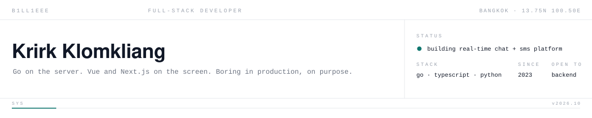
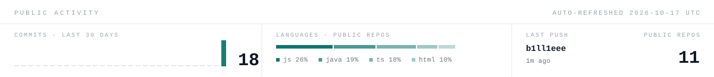
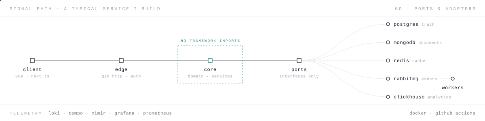
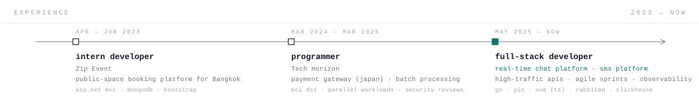
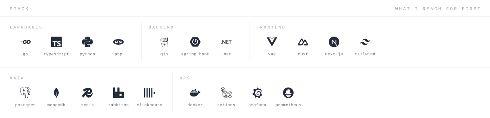

Full-stack developer in Bangkok. I build Go services with a framework-free core, put Vue or Next.js in front of them, and run everything in Docker with Grafana watching. Right now: a real-time chat platform and an SMS product.

<a href="mailto:krirk.klomkliang@gmail.com">krirk.klomkliang@gmail.com</a> &nbsp;·&nbsp; Bangkok, Thailand

