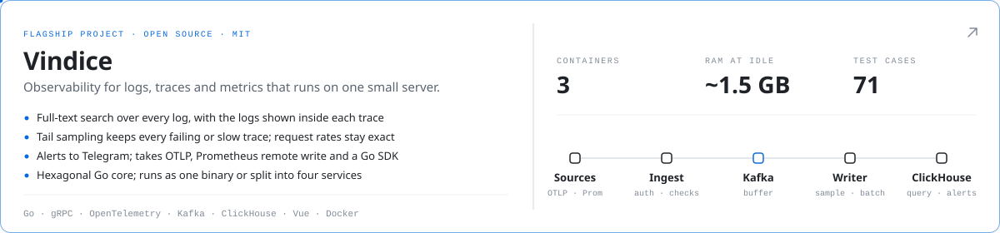
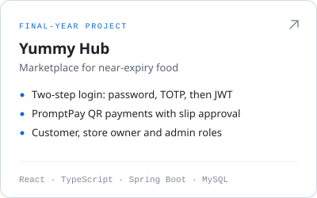
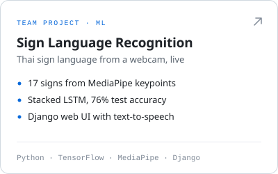
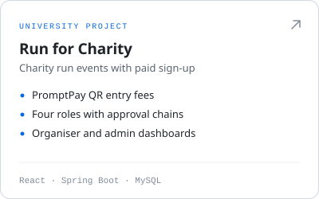
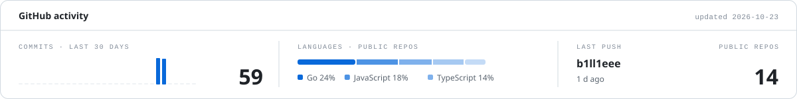
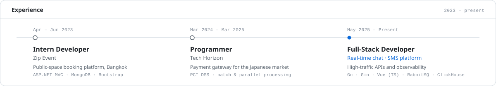

<picture>
  <source media="(prefers-color-scheme: dark)" srcset="assets/hero-dark.svg">
  
</picture>

  <a href="mailto:krirk.klomkliang@gmail.com">Email</a> &nbsp;·&nbsp;
  <a href="https://github.com/b1ll1eee?tab=repositories">Repositories</a> &nbsp;·&nbsp;
  Bangkok, Thailand

Full-stack developer with a backend focus. I design Go services around a framework-free domain core, build Vue and Next.js frontends on top of them, and run everything in Docker with full observability on the LGTM stack. Previously delivered payment-gateway features under PCI DSS; currently working on a real-time chat platform and an SMS platform, and building Vindice, a self-hosted observability stack, on the side.

<a href="https://github.com/b1ll1eee/vindice-obs"><picture>
  <source media="(prefers-color-scheme: dark)" srcset="assets/flagship-dark.svg">
  
</picture></a>

  <a href="https://github.com/b1ll1eee/yummy-hub"><picture>
    <source media="(prefers-color-scheme: dark)" srcset="assets/project-yummy-hub-dark.svg">
    
  </picture></a>
  <a href="https://github.com/b1ll1eee/sign-language-recognition"><picture>
    <source media="(prefers-color-scheme: dark)" srcset="assets/project-sign-language-recognition-dark.svg">
    
  </picture></a>
  <a href="https://github.com/b1ll1eee/run-for-charity"><picture>
    <source media="(prefers-color-scheme: dark)" srcset="assets/project-run-for-charity-dark.svg">
    
  </picture></a>

<picture>
  <source media="(prefers-color-scheme: dark)" srcset="assets/pulse-dark.svg">
  
</picture>

<picture>
  <source media="(prefers-color-scheme: dark)" srcset="assets/timeline-dark.svg">
  
</picture>

<picture>
  <source media="(prefers-color-scheme: dark)" srcset="assets/system-dark.svg">
  
</picture>

<picture>
  <source media="(prefers-color-scheme: dark)" srcset="assets/stack-dark.svg">
  
</picture>
