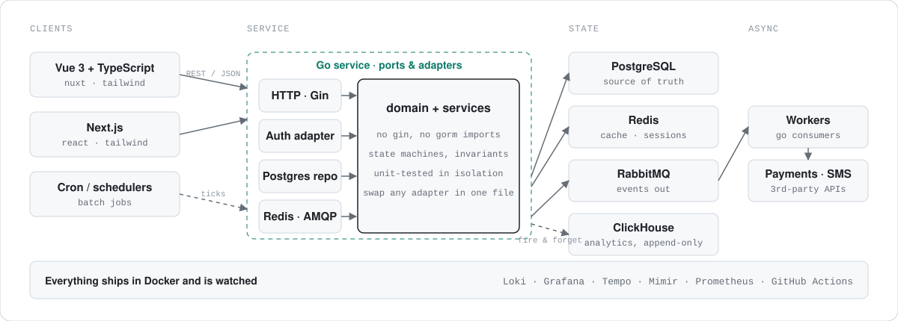

<picture>
  <source media="(prefers-color-scheme: dark)" srcset="assets/hero-dark.svg">
  
</picture>

I build the parts of a product that have to keep working when nobody is looking: payment batches, chat sockets, SMS pipelines. Backend in Go, frontend in Vue or Next.js, everything in Docker with Grafana watching it.

By day I work on a real-time chat platform and an SMS product. At night I'm teaching a local LLM to behave like a team of specialists.

  <a href="mailto:krirk.klomkliang@gmail.com">krirk.klomkliang@gmail.com</a>
  &nbsp;·&nbsp; Bangkok, Thailand
  &nbsp;·&nbsp; <a href="https://github.com/b1ll1eee?tab=repositories">repositories</a>

## The shape of what I build

<picture>
  <source media="(prefers-color-scheme: dark)" srcset="assets/arch-dark.svg">
  
</picture>

The core never imports Gin or GORM. Adapters are thin and swappable, so a Postgres repo can become a fake in tests, and a REST handler can become a queue consumer without touching business rules.

## Stack

| | |
|---|---|
| **Backend** | Go, Gin, hexagonal architecture. Earlier: Spring Boot, ASP.NET MVC, PHP. |
| **Frontend** | Vue 3 with TypeScript, Nuxt, Next.js, Tailwind CSS. |
| **Data** | PostgreSQL, MySQL, MongoDB, Redis, RabbitMQ, ClickHouse. |
| **Ops** | Docker, GitHub Actions, Loki / Grafana / Tempo / Mimir, Prometheus, Linux. |
| **Security** | JWT, MFA, RBAC, brute-force protection. Shipped under PCI DSS on a payment gateway. |

## Now

- Scaling the real-time chat backend: Go, RabbitMQ fan-out, ClickHouse for message analytics.
- Writing READMEs for the Scribe repos so they explain themselves.
- Adding a `research` profile to morty-model, with its own eval set.

Before this

 

- **2024 to 2025:** Programmer on a Japan-based payment gateway. Batch processing, parallel workloads, third-party integrations, security reviews, PCI DSS.
- **2023:** Intern at Zip Event, building the booking flow for Bangkok's public-space platform on ASP.NET MVC and MongoDB.
- **B.Eng. Computer Engineering,** Kasetsart University, Kamphaeng Saen. Side projects included a charity-run platform with PromptPay QR donations and a near-expiry food marketplace.

 

<picture>
  <source media="(prefers-color-scheme: dark)" srcset="https://raw.githubusercontent.com/b1ll1eee/b1ll1eee/output/github-contribution-grid-snake-dark.svg">
  
</picture>
